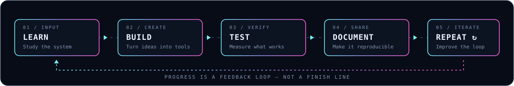

<div align="center">



<br/>

<a href="https://github.com/Phantomterminal">
  
</a>
<a href="https://github.com/Phantomterminal?tab=repositories">
  
</a>


<br/><br/>

### `I build. I break things safely. I learn how they work.`

**Developer** &nbsp;·&nbsp; **Cybersecurity Enthusiast** &nbsp;·&nbsp; **AI Explorer**

[ `01 / ABOUT` ](#-01--the-operator) &nbsp; ◈ &nbsp;
[ `02 / PROJECTS` ](#-02--active-builds) &nbsp; ◈ &nbsp;
[ `03 / STACK` ](#-03--the-toolkit) &nbsp; ◈ &nbsp;
[ `04 / JOURNEY` ](#-04--learning-protocol) &nbsp; ◈ &nbsp;
[ `05 / CONNECT` ](#-05--open-a-channel)

</div>

---

<div align="center">

`SYSTEM STATUS` &nbsp;  &nbsp; `OPERATING MODE` &nbsp; 

</div>

## ◈ `01 / THE OPERATOR`

```text
╭────────────────────────────────────────────────────────────────╮
│  USER       : Swastik Dwivedi                                   │
│  HANDLE     : Phantomterminal                                  │
│  INTERESTS  : Cybersecurity / Software / AI                    │
│  APPROACH   : Understand → Experiment → Validate → Improve     │
│  DIRECTIVE  : Build useful things. Test responsibly. Share.    │
╰────────────────────────────────────────────────────────────────╯
```

I'm a developer exploring the overlap between **cybersecurity, software development, and AI**. I like learning how systems behave under the hood, testing ideas in authorized labs, and turning experiments into tools that solve real problems.

<table>
<tr>
<td width="50%" valign="top">

### `// SECURITY MINDSET`

- Network reconnaissance & service enumeration
- Ethical security testing in controlled environments
- Threat intelligence and risk analysis
- Defensive thinking and remediation
- Curiosity about how systems fail — and how to make them stronger

</td>
<td width="50%" valign="top">

### `// BUILDER MINDSET`

- Python, scripting, and automation
- Linux and command-line workflows
- AI-assisted tools and local LLM experiments
- Practical dashboards and developer tooling
- Learning in public; improving one iteration at a time

</td>
</tr>
</table>

> **Principle:** Security skills are for authorized testing, responsible disclosure, and making systems safer.

---

## ◈ `02 / ACTIVE BUILDS`

<div align="center">
<table>
<tr>
<td width="50%" valign="top">

<a href="https://github.com/Phantomterminal?tab=repositories">

</a>

### 🛡️ AI Red Team Orchestrator

An AI-assisted security workflow concept for **authorized labs**: reconnaissance, service enumeration, scan interpretation, risk reasoning, attack-path analysis, and mitigation guidance.

`PYTHON` · `FASTAPI` · `NMAP` · `OLLAMA / QWEN`

[**Explore repositories ↗**](https://github.com/Phantomterminal?tab=repositories)

</td>
<td width="50%" valign="top">

<a href="https://github.com/Phantomterminal?tab=repositories">

</a>

### 👁️ AI Video Attendance

A computer-vision system concept for attendance workflows, student records, manual correction, and dashboard-based administration.

`PYTHON` · `COMPUTER VISION` · `DASHBOARD`

[**Explore repositories ↗**](https://github.com/Phantomterminal?tab=repositories)

</td>
</tr>
<tr>
<td width="50%" valign="top">

<a href="https://github.com/Phantomterminal?tab=repositories">

</a>

### 🌱 Krishi Drishti AI

An agriculture-focused AI idea exploring how practical, accessible insights could support field-level decisions.

`AI` · `RESEARCH` · `PROBLEM SOLVING`

</td>
<td width="50%" valign="top">

<a href="https://github.com/Phantomterminal?tab=repositories">

</a>

### 🎬 AI Video Generator

Exploring AI-assisted media workflows, from content selection and clip processing to repeatable creative automation.

`PYTHON` · `AUTOMATION` · `AI TOOLS`

</td>
</tr>
</table>
</div>

<sub>Project descriptions reflect concepts and areas of work discussed for this profile. Follow the linked repositories for actual source code and implementation status. Project cards are not claims that every concept is already a finished release.</sub>

---

## ◈ `03 / THE TOOLKIT`

<div align="center">


<br/><br/>


</div>

<table>
<tr>
<th>DOMAIN</th>
<th>CURRENT FOCUS</th>
</tr>
<tr><td>Programming</td><td>Python, C, scripting, readable code</td></tr>
<tr><td>Systems</td><td>Linux, terminal workflows, troubleshooting</td></tr>
<tr><td>Security</td><td>Networking, reconnaissance, lab methodology, remediation</td></tr>
<tr><td>AI</td><td>Local LLMs, structured analysis, practical automation</td></tr>
</table>

---

## ◈ `04 / LEARNING PROTOCOL`



| NEXT OBJECTIVE | WHY IT MATTERS |
|:--|:--|
| Networking fundamentals | Understand traffic, protocols, ports, and services |
| Linux & Python | Automate tasks and understand the environment |
| Web security | Learn common weaknesses and how to prevent them |
| Detection & defense | Connect offensive findings to practical remediation |
| Responsible red teaming | Test only with permission and report findings clearly |

<sub>These are learning priorities, not claims of certification or expert-level proficiency.</sub>

---

## ◈ `05 / GITHUB TELEMETRY`

<div align="center">


<br/>


<br/>

<a href="https://github.com/Phantomterminal?tab=activity">

</a>

</div>

<sub>Statistics and language cards are generated by external services and may occasionally be unavailable or rate-limited. Language charts reflect repository contents, not a complete measure of skill.</sub>

---

## ◈ `06 / OPEN A CHANNEL`

<div align="center">

If you're building something interesting, learning security, or improving an open-source project, let's connect and learn from each other.

<br/>

<a href="https://github.com/Phantomterminal?tab=repositories">

</a>
<a href="https://www.linkedin.com/">

</a>

<br/><br/>



`END OF TRANSMISSION`  
<sub>STAY CURIOUS · STAY ETHICAL · KEEP SHIPPING</sub>

</div>

